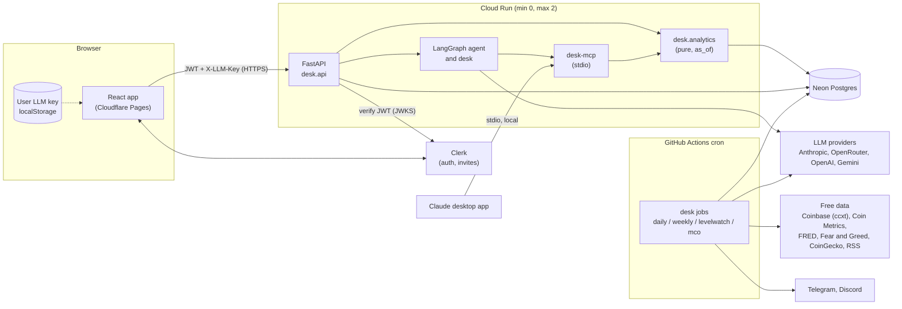

# Architecture

The stack (copied from ROADMAP Section 6; update both together):

| Layer | Choice | Why |
|---|---|---|
| Frontend | React + TypeScript + Vite, Tailwind CSS, shadcn/ui, TanStack Query, React Router | Standard, fast, app-like tabs; Claude Code knows it well |
| Price charts | **TradingView Lightweight Charts** (open source, Apache 2.0) | Proper financial charts, fast. **Keep the required TradingView attribution** (verify the current license notice) |
| Other charts | Apache ECharts | Heatmaps, distributions, cycle overlays with log axes |
| Frontend hosting | Cloudflare Pages (free) | Free static hosting, generous bandwidth |
| Backend | Python 3.12, FastAPI, SQLAlchemy 2.0, Alembic, `uv` | Reuses the Python analytics, LangGraph and MCP code |
| Backend hosting | Google Cloud Run (free tier, min instances 0) | Rob already uses it; scales to zero; supports SSE streaming. Set a GCP budget alert at $1 |
| Database | Neon Postgres (free tier) | Rob already uses it; serverless; use the pooled connection string |
| Auth | Clerk (free tier) | Invite-only now, open sign-up later; React SDK; JWT verification in FastAPI |
| Scheduled jobs | GitHub Actions cron (free for public repos) | Runs `desk jobs ...` against Neon |
| Agents | LangGraph + LangChain (Anthropic, OpenAI, OpenRouter via the OpenAI-compatible client) + `langchain-mcp-adapters`; LangSmith free tier for tracing | Same skills as ESSCONTI; agents, evals and observability |
| MCP | Official `mcp` Python SDK (`FastMCP`), stdio | `desk-mcp` for the in-app agent and for Rob's Claude desktop app |
| Video summaries | Gemini API (Flash-class model, free tier if quotas allow) | Reads public YouTube videos by URL from the cloud |
| Alerts | Telegram Bot API, Discord webhook | Free |

## Components

- **One analytics core.** `desk.analytics` holds pure functions that take `as_of`. The API routes and the `desk-mcp` tools both call them, so a number on screen and a number the agent used come from the same code.
- **Writes happen in jobs.** GitHub Actions cron runs `desk jobs ...` against Neon. The API is mostly read-only, apart from users, conversations, agent snapshots and admin actions.
- **User keys never persist.** They live in the browser and arrive per request in `X-LLM-Key`. They are never logged, stored or traced (Section 3.6, canary test).
- **MCO data is private.** It lives only in the database behind logged-in routes (Decision 6).
- **Contract.** FastAPI's OpenAPI schema → `frontend/openapi.json` → `src/lib/api-schema.ts` (generated). CI fails if they drift.
